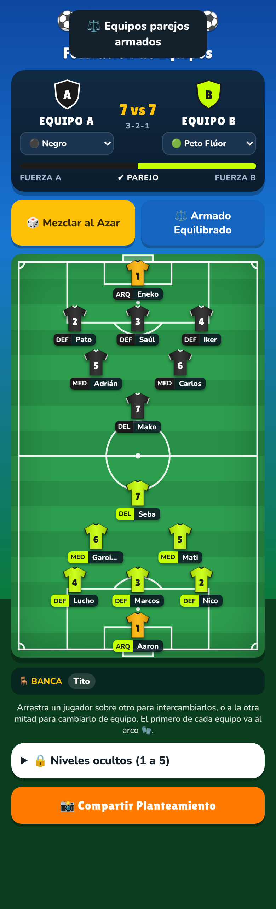

# ⚽ Pichanga.app

Organizador de pichangas para el celular: convocatoria, armado de equipos y cobros, todo listo para compartir por WhatsApp.

## Pantallas

- **📅 Convocatoria:** fecha, hora y lugar (con enlace a Google Maps), selector de jugadores por lado, botones de "caseros" para sumar a los de siempre con un toque, suplentes automáticos cuando se llena el cupo (y un aviso "📲 Avisar" para quien sube a titular) y mensaje formateado para WhatsApp. Tocar un nombre permite corregirlo sin perder su lugar, pagos, nivel ni deudas, y "✏️ Editar" en los caseros permite renombrarlos, unir duplicados o quitarlos. "carlos", "Carlos" y "Cárlos" se reconocen como la misma persona.
- **👕 Equipos:** cancha táctica con formación según la cantidad de jugadores, color de petos por equipo, mezcla al azar, armado equilibrado según niveles ocultos (1 a 5), niveles también para suplentes y caseros, arrastrar para intercambiar jugadores (soltar fuera de la cancha cancela; un equipo no pasa de N) e imagen del planteamiento para compartir. Los colores de los equipos nunca se repiten y el arquero usa un color que se distingue de ambos.
- **💰 Pagos:** datos bancarios con QR o link de cobro, cuota de cancha por persona (acepta montos como "49.000"; si no da justo, algunos pagan $1 más para que las cuotas sumen exacto el total), división del tercer tiempo 🍻 solo entre los que se quedan (también suplentes; un suplente que entró a jugar ⚽ paga cancha), botón para compartir o quitar el QR, registro de cuánto pagó cada uno ("pagó $X · falta $Y", recaudado del día) y cobranza por WhatsApp con el detalle de cada deuda.
- **⚠️ Libreta de deudas:** lo que cada jugador quedó debiendo, con monto y fecha, juegue o no esa semana. Se puede saldar completo, abonar una parte, ponerle monto a una deuda antigua que no lo tenía o mandarle un recordatorio por WhatsApp, y el monto aparece junto a su nombre en Convocatoria. Si alguien pagó y no jugó (o pagó de más), queda con saldo a favor 💚, que se descuenta solo de su próxima cuota.
- **🏁 Cerrar pichanga:** en un solo paso guarda el resultado (una vez por fecha), anota en la libreta a quienes no pagaron y deja lista la próxima fecha (+7 días, misma hora, lugar y costo). En Convocatoria, "🔁 Misma lista que la semana pasada" inscribe a todos de un toque.
- **🏆 Post-Partido:** marcador del partido, votación por WhatsApp para elegir ⭐ MVP, 👟 Goleador y 🪓 El Rústico, fecha del partido editable (también desde el historial), historial ordenado por fecha y tabla del mes (victorias por color de camiseta y ranking de premios con empates) para compartir al grupo.

## Cómo usarla

Ábrela en https://tolstoy789.github.io/Mi_Pichanga/ desde el celular y usa **"Agregar a pantalla de inicio"** para instalarla como app. Funciona sin conexión.

Las acciones importantes (bajar a alguien, cerrar la pichanga, saldar o anotar una deuda, marcar un pago, 🔁 Misma lista, armar equipos, guardar el partido) muestran **↩️ Deshacer** por unos segundos. El botón se va apenas se hace otra cosa, para que nunca parezca que deshace lo último.

Los datos se guardan en el mismo teléfono. En la pestaña 🏆 Post-Partido puedes guardar un respaldo (archivo `.json`) y restaurarlo en otro celular; la app recuerda cuándo fue el último respaldo y avisa si el teléfono se queda sin espacio para guardar. Si la app está abierta en dos ventanas a la vez, cada una carga lo que guarda la otra.

Es una sola página (`index.html`) sin dependencias ni paso de compilación; `sw.js` y `manifest.webmanifest` la hacen instalable y usable sin internet.

Pruebas automáticas (Node + Playwright): `node tests/e2e.mjs`.

